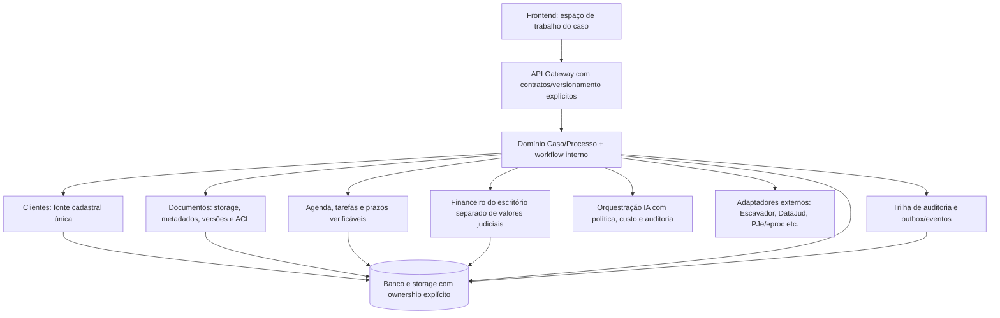

# Arquitetura e integrações

## Estado atual

O diagrama é lógico; não indica que cada ligação tenha sido testada em ambiente implantado. A implantação Hostinger possui microserviços, porém o gateway também usa `hubkealex` como fallback. O frontend utiliza caminhos `/k1` e `/v1`; alguns domínios têm caminhos equivalentes em serviços e monólito. Exemplo: `DocumentosPage` usa `/k1/lex/documentos`, enquanto `svc-documentos` documenta CRUD em `/v1/lex/documentos`; o CRUD `/k1` também existe no `app/api/routes/resource_routes.py` central. A seleção real do serviço depende de `api-gateway/nginx.conf` e do Compose implantado.

## Entidades e relações relevantes

Algumas linhas representam relações lógicas, não necessariamente FKs presentes no schema. A entidade de acompanhamento não aponta para `PROCESSO`; conversa de análise não aponta para cliente/processo; atividade não contém `process_id`; o CRUD de audiências recebe título e um `processId` vazio pela tela. IDs interdomínio e duplicação de modelos exigem consistência por serviço e migrações coordenadas.

## Principais riscos arquiteturais

- **Dois caminhos de execução:** aplicação central e microserviços implementam tabelas/domínios parcialmente iguais; serviço de destino pode variar com gateway/deploy.
- **Contratos divergentes:** prefixos, métodos, schemas e capacidades variam; corrigir endpoint em um serviço não corrige necessariamente fallback central/prod.
- **Banco compartilhado:** vários serviços usam MySQL e modelos duplicados; mudanças requerem migração versionada e compatibilidade entre versões.
- **Acoplamento à camada legada:** `app/main.py` importa `legacy_context` e vários routers centrais; novos fluxos não devem continuar ampliando esse contexto.
- **Confiabilidade transacional:** operações multietapas de processo + clientes + partes podem persistir parcialmente; a UI comunica que o processo foi salvo e depois pode falhar em vínculos.
- **Auditoria incompleta do domínio:** histórico está presente em cobrança e acompanhamento, mas alterações de cadastro, peça, estado interno e download de documentos não têm trilha uniforme demonstrada.

## Arquitetura recomendada (evolutiva)

Não é recomendada a criação imediata de novos serviços. Primeiro, definir propriedade de entidades/rotas, contratos e gateway; modelar Caso/ProcessoInterno e vínculo com processo oficial; centralizar documentos e auditoria. Extrair serviços só com limites e escala justificados.

## Integrações: capacidades e dependências

| Integração | Evidência | Dependências / limite |
|---|---|---|
| Escavador | Adapter em `svc-integracoes`; proxy de serviço de processos | Token contratado, custo/limites, idempotência/cache, consentimento/base legal e orçamento; consulta não executada. |
| DataJud | `svc-usuarios/app/api/routes/datajud_routes.py` | Chave pública e mapeamento tribunal; resposta de consulta não equivale a peticionamento. |
| PJe/eproc/e-SAJ/Projudi/SEI | Nenhum adaptador de protocolo encontrado na jornada auditada | Acesso oficial, autenticação, autorização, certificação e termos de cada sistema; estimar separadamente. |
| Google Drive | OAuth e leitura no módulo de análise | Escopos, consentimento, tokens cifrados, ACL e associação dos itens ao caso. |
| FiscalAPI/portais | Serviço de integração e catálogo central de certificados | Credenciais/contratos; modalidades e custos variam. A maior parte do catálogo não é emissão via API. |
| Asaas | Cobrança SaaS, recargas e cobrança de honorários | Webhooks autenticados/idempotentes, tokenização de cartão, conciliação e ambiente sandbox. |
| Provedores LLM | AI Hub, agentes, análise documental | Chave por usuário/tenant, política de retenção, custo, logging seguro, fontes verificáveis e revisão humana. |

## Operação, migração e testes

Antes de novos fluxos, elaborar inventário de roteamento por Compose ativo, prefixo, método e serviço real. Definir contrato canônico para cada domínio e automatizar contrato/gateway tests. Migrações devem ser versionadas; `Base.metadata.create_all()` cria tabelas ausentes, mas não altera tabelas existentes. Não executar migrations nesta auditoria.
